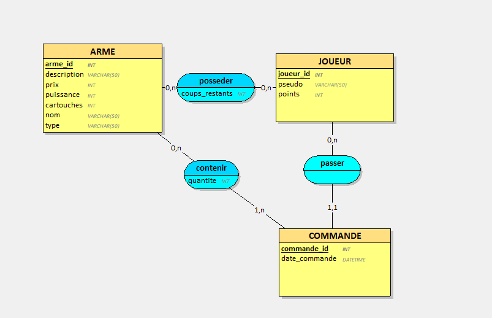

<div align="center">
    Auteur : David Sottas<br>
    ETML - Vennes<br>
    Chef de projet : Mathieu Meylan
</div><br>

## Table des Matières
1. [MCD](#mcd)
2. [Create tables](#create-tables)
3. [Load data](#load-data)
4. [Backup restore](#backup-restore)
5. [Select](#select)
6. [Index](#index)
7. [Utilisateurs et rôles](#uilisateurs-et-rôles)

## MCD

Le MCD (Modèle de Conceptualisation de Données) contient 3 tables : ARME, JOUEUR et COMMANDE. Chacune de ces tables a des colonnes qui définissent celles-ci. Il y a également des associations avec des cardinalitées qui relient les tables.



## Create tables

Le script `CreateTables.sql` trouvé dans src/scripts dois être déplacer dans le dossier scripts de docker. Il est ensuite éxecutable en effectuant, dans le terminal docker, la commande :

```sql
SOURCE /scripts/CreateTables.sql;
```

Le script permet de créer la base de données et les tables avec toutes leurs associations

## Load data

Le script `LoadData.sql` trouvé dans src/scripts dois également être déplacer dans le dossier scripts de docker. Il est ensuite éxecutable en effectuant, dans le terminal docker, les commandes :

Pour se connecter en autorisant le local :

```bash
mysql --local-infile -u user -ppassword
```

Pour éxecuter le fichier : 

```sql
SOURCE /scripts/LoadData.sql;
```

## Backup restore

Afin de sauvergarder la base de données, un mysqldump est utilisé. Celle-ci sera sauvegardé dans un fichier .sql nommé : `db_space_invaders_backup.sql`. 
Pour parvenir à ce résultat, il faut effectuer, dans le terminal docker, cette commande: 

```bash
mysqldump -u root -proot db_space_invaders > db_space_invaders_backup.sql
```

Quant à la restauration de la base de données, il faut avoir le fichier `db_space_invaders_backup.sql` et effectuer, dans le terminal docker, cette commande :

```bash
mysql -u root -p db_space_invaders < db_space_invaders_backup.sql
```

## Selects

####  Requête n°1 :  

Sélectionner les 5 joueurs qui ont le meilleur score c’est-à-dire qui ont le nombre de points le plus élevé. Les joueurs doivent être classés dans l’ordre décroissant :

```sql
SELECT * FROM t_joueur 
ORDER BY points DESC 
LIMIT 5;
```

#### Requête n°2 :  

Trouver le prix maximum, minimum et moyen des armes : 

```sql
SELECT MAX(prix) AS PrixMaximum, MIN(prix) AS PrixMinimum, AVG(prix) AS PrixMoyen
FROM t_arme;
```

#### Requête n°3 :  

Trouver le nombre total de commandes par joueur et trier du plus grand nombre au plus petit : 

```sql
SELECT joueur_fk AS IdJoueur, COUNT(*) AS NombreCommandes
FROM t_commande
GROUP BY IdJoueur
ORDER BY NombreCommandes DESC;
```

#### Requête n°4 :  

Trouver les joueurs qui ont passé plus de 2 commandes : 

```sql
SELECT joueur_fk AS IdJoueur, COUNT(*) AS NombreCommandes
FROM t_commande
GROUP BY IdJoueur
HAVING NombreCommandes > 2;
```

#### Requête n°5 :

Trouver le pseudo du joueur et le nom de l'arme pour chaque commande : 

```sql
SELECT j.pseudo, a.nom
FROM t_commande c
JOIN t_joueur j ON c.joueur_fk = j.joueur_id
JOIN contenir co ON c.commande_id = co.commande_fk
JOIN t_arme a ON co.arme_fk = a.arme_id;
```

#### Requête n°6:  

Trouver le total dépensé par chaque joueur en ordonnant par le montant le plus élevé en premier, et limiter aux 10 premiers joueurs : 

```sql
SELECT j.joueur_id, SUM(co.quantite * a.prix) AS TotalDepense
FROM t_joueur j
JOIN t_commande c ON j.joueur_id = c.joueur_fk
JOIN contenir co ON c.commande_id = co.commande_fk
JOIN t_arme a ON co.arme_fk = a.arme_id
GROUP BY j.joueur_id
ORDER BY TotalDepense DESC
LIMIT 10;
```

#### Requête n°7:  

Récupérez tous les joueurs et leurs commandes, même s'ils n'ont pas passé de commande : 

```sql
SELECT j.pseudo, c.commande_id
FROM t_joueur j
LEFT JOIN t_commande c ON j.joueur_id = c.joueur_fk;
```

#### Requête n°8: 

Récupérer toutes les commandes et afficher le pseudo du joueur s’il existe, sinon montrer `NULL` pour le pseudo : 

```sql
SELECT c.commande_id, j.pseudo
FROM t_commande c
LEFT JOIN t_joueur j ON c.joueur_fk = j.joueur_id;
```

#### Requête n°9:

Trouver le nombre total d'armes achetées par chaque joueur (même si ce joueur n'a acheté aucune Arme) : 

```sql
SELECT j.pseudo, IFNULL(SUM(co.quantite), 0) AS TotalArmesAchetees
FROM t_joueur j
LEFT JOIN t_commande c ON j.joueur_id = c.joueur_fk
LEFT JOIN contenir co ON c.commande_id = co.commande_fk
GROUP BY j.joueur_id;
```

#### Requête n°10: 

Trouver les joueurs qui ont acheté plus de 3 types d'armes différentes :

```sql
SELECT j.pseudo
FROM t_joueur j
JOIN t_commande c ON j.joueur_id = c.joueur_fk
JOIN contenir co ON c.commande_id = co.commande_fk
GROUP BY j.joueur_id
HAVING COUNT(DISTINCT co.arme_fk) > 3;
```

## Index

Dans la solutions, des index on été automatiquement crée pour chaque clé primaire afin de garantir l'unicité et accélérer l'accès à ces clés. Dans l'exemple, l'ajout de cet index sur joueur_fk nous permet d'obtenir les même avantages.

Pour ajouter un index manuellement dans par exemple `joueur_fk` de `t_commande`, il faut effectuer :

```sql
CREATE INDEX idx_commande_joueur ON t_commande (joueur_fk);
```

Un index "idx_commande_joueur" étant déjà présent dans la table t_commande, le CREATE INDEX ci-dessus retournera :

```sql
Duplicate key name 'idx_commande_joueur'
```
## Uilisateurs et rôles

Le script `CreateUsersRoles.sql` trouvé dans src/scripts dois être déplacer dans le dossier scripts de docker. Il est ensuite éxecutable en effectuant, dans le terminal docker, la commande :

```sql
SOURCE /scripts/CreateUsersRoles.sql;
```

### Tableau des utilisateurs et rôles
| Utilisateur | Rôle | Tables | Permissions |
| :--- | :--- | :--- | :--- |
| **`admin1@localhost`** | `admin` | `*.*` | **ALL PRIVILEGES** |
| **`joueur2@localhost`** | `joueur` | `t_arme` | **SELECT** |
| **`joueur2@localhost`** | `joueur` | `t_commande`<br>`contenir` | **INSERT, SELECT** |
| **`gestionnaire3@localhost`** | `gestionnaire` | `t_arme` | **SELECT, INSERT, UPDATE, DELETE** |
| **`gestionnaire3@localhost`** | `gestionnaire` | `t_joueur`<br>`t_commande`<br>`contenir` | **SELECT** |

* **L'Admin (`admin1`)** : Il a toutes les permissions sur la base de données du jeu et possède les droits d'administration serveur.
* **Le Joueur (`joueur2`)** : Il a un profil limité. Il peut voir les armes disponibles et passer des commandes (insérer dans `t_commande` et `contenir`), mais ne peut rien modifier ni supprimer.
* **Le Gestionnaire (`gestionnaire3`)** : Il gère principalement l'inventaire des armes (Controle complet sur `t_arme`), mais ne peut que consulter les joueurs et les commandes sans pouvoir les modifier.